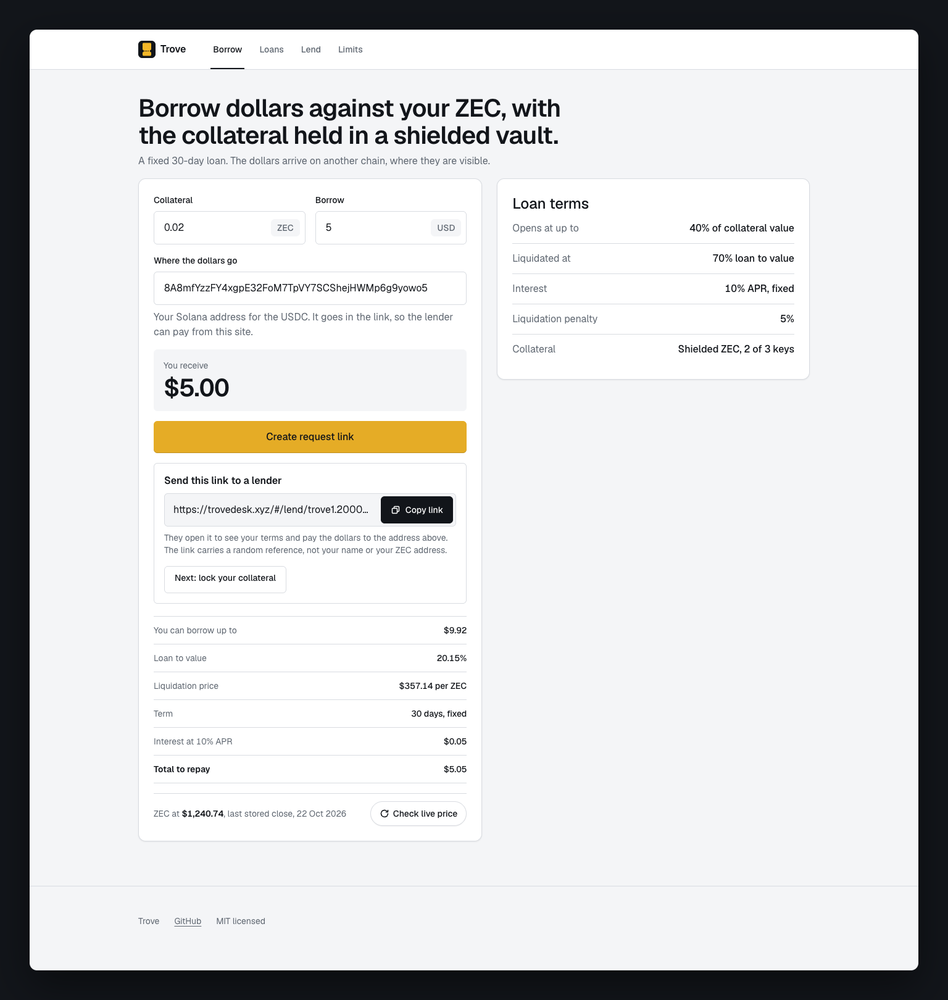
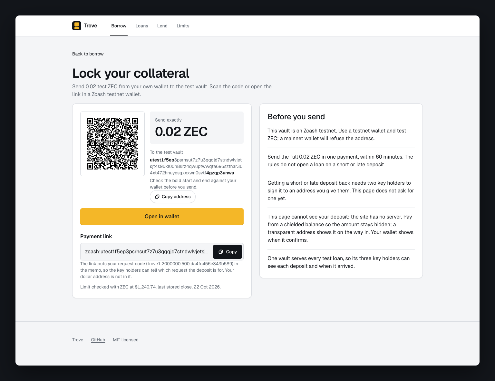
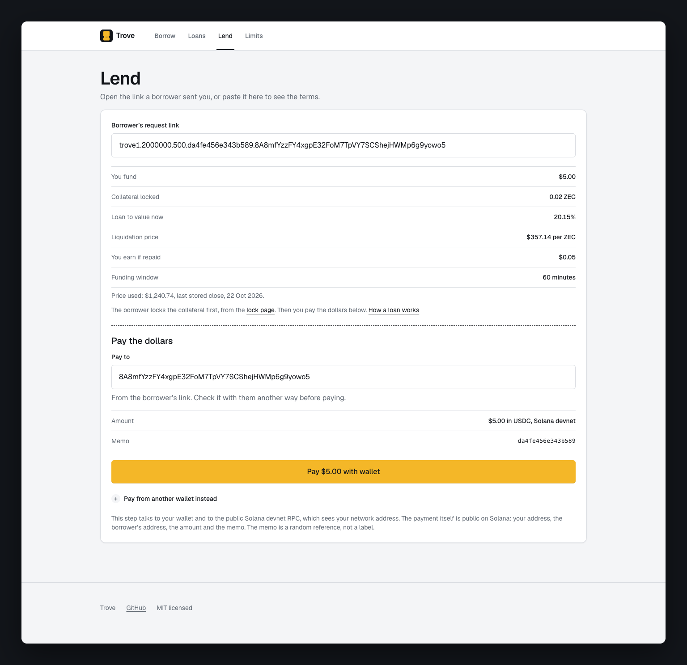
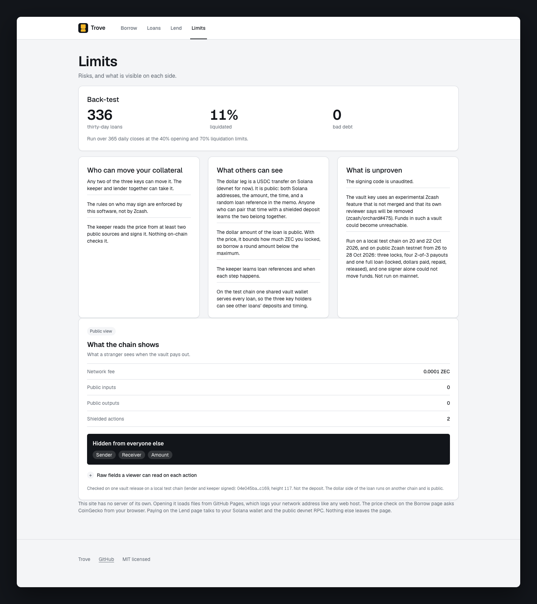
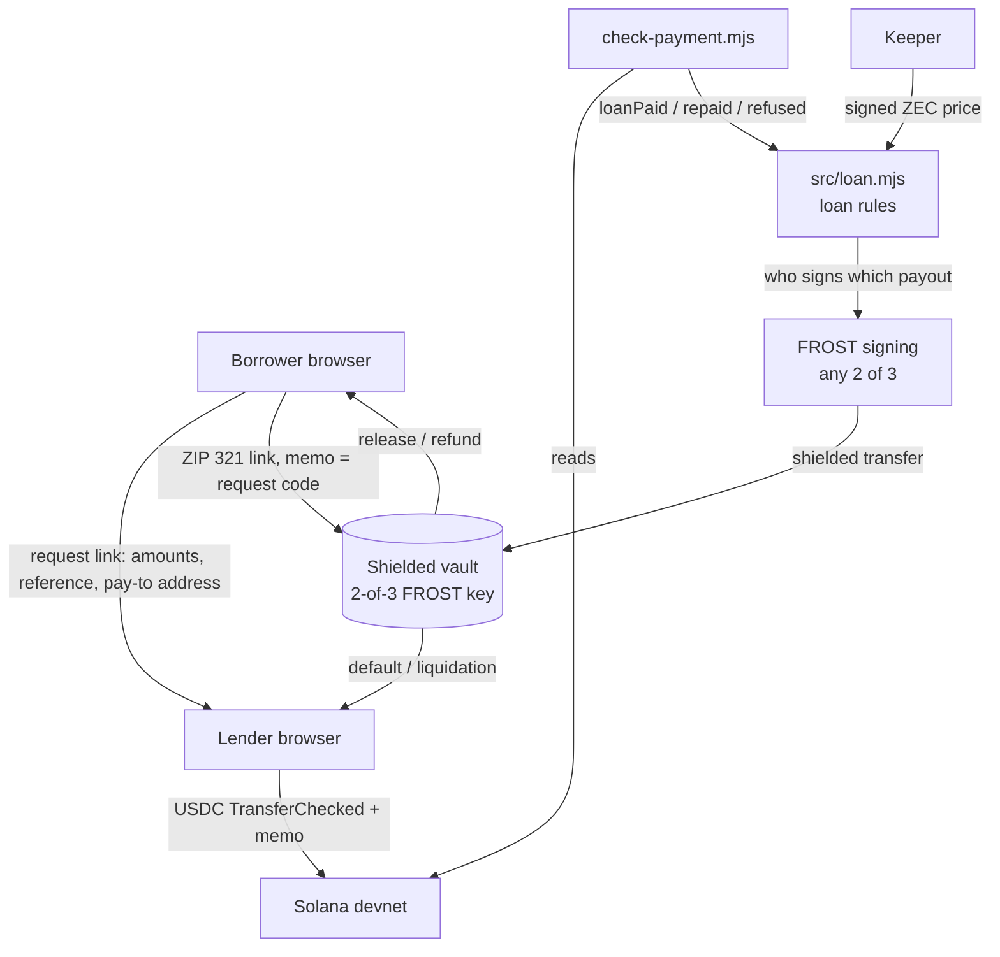

<div align="center">

# Trove

[](https://github.com/Yonkoo11/trove/actions/workflows/test.yml)


[](https://trovedesk.xyz)

### Borrow dollars against ZEC without selling it, with the collateral held in a shielded vault.

**Trove is a fixed-term loan desk for two parties. The borrower's ZEC sits in a shielded Zcash vault whose spend key is split 2-of-3 (FROST) between borrower, lender and a keeper, and the dollars move as USDC on Solana with the loan's random reference as the memo. One loan has run end to end on public test networks: locked, paid, repaid and released, with a chain viewer seeing nothing of the ZEC side but the fee.**

**[ Live ↗ ](https://trovedesk.xyz)** · **[ Verify it yourself ](#verify-it-yourself-in-60-seconds)** · **[ The release on chain ↗ ](https://testnet.cipherscan.app/tx/a34f20398394d4d34638fb79f9afc09f55cf734683febda8ae2716587b88f1c6)** · **[ Before mainnet ](docs/MAINNET.md)**

Built for Zecathon (Private Markets track). Test networks only, no real funds.

</div>



---

## Demo

*The site in the order a loan happens: borrow (above), then lock, lend and limits. Every still is a full-page capture of the app, taken by `scripts/readme-shots.mjs`.*

| Lock: send exactly 0.02 ZEC to the vault by QR or payment link, with the request code as the memo | Lend: the lender's terms and the $5.00 USDC transfer built for their wallet, memo = the loan reference | Limits: what stays public, who can move the collateral, what the chain shows |
|---|---|---|
|  |  |  |

---

## Table of contents
- [The problem](#the-problem)
- [What Trove is](#what-trove-is)
- [Verify it yourself in 60 seconds](#verify-it-yourself-in-60-seconds)
- [The headline result](#the-headline-result)
- [Architecture](#architecture)
- [Who can move the collateral](#who-can-move-the-collateral)
- [What the chain shows](#what-the-chain-shows)
- [What's real, and what we deliberately did not claim](#whats-real-and-what-we-deliberately-did-not-claim)
- [What this does not hide or stop](#what-this-does-not-hide-or-stop)
- [Tech stack](#tech-stack)
- [Project layout](#project-layout)
- [Run it locally](#run-it-locally)
- [Tests](#tests)

## The problem

- **Borrowing against ZEC today means selling the privacy with it.** A lending contract on a transparent chain publishes the collateral amount, the address and every movement.
- **The other option is one custodian.** Then a single party holds the key, and the borrower trusts them with the coins and the record.

## What Trove is

A loan desk where the ZEC never leaves a shielded vault that no single party can spend from. The loop:

<div align="center">

**`REQUEST → LOCK → PAY → REPAY → RELEASE`**

</div>

1. **Request.** The borrower enters ZEC, a dollar amount and, if they want to be paid through the site, their Solana address. The page makes a request link holding those plus a random 16-hex loan reference drawn in the browser (`site/lib/terms.mjs`). No name, no ZEC address.
2. **Lock.** `#/lock/<code>` shows a QR code and a ZIP 321 payment link to the shared testnet vault, memo = the request code. The borrower pays from their own wallet. The vault's spend key is 2-of-3 FROST: borrower, lender, keeper.
3. **Pay.** The lender opens the link, checks the terms, and the Lend page builds one Solana devnet transaction (create the borrower's USDC account if missing, TransferChecked, memo = the loan reference) for their browser wallet to sign. `scripts/check-payment.mjs` confirms the transfer landed with the right memo, amount, sender and recipient before the loan counts as funded.
4. **Repay.** The borrower sends principal plus interest back the same way. The checker counts it as `repaid` and refuses it as a loan payment.
5. **Release.** Two of the three keys sign a FROST session and the vault sends the ZEC back to the borrower as one more shielded transfer. The rules in `src/loan.mjs` fix who gets paid in each ending: repaid goes to borrower and lender, defaulted or liquidated to lender and keeper, aborted or refunded to borrower and keeper.

The site covers steps 1 to 4. Step 5 and the other payouts ran from `scripts/lifecycle.mjs` (regtest) and `spike-scripts/` (testnet). There is no server and no running service.

## Verify it yourself in 60 seconds

No key, no wallet, no chain node. The payment checks read public Solana devnet. Every expected output below was produced by a run on 28 Oct 2026 before it was written here.

```bash
git clone https://github.com/Yonkoo11/trove.git && cd trove
npm test                       # tests 129, pass 129, fail 0

# the $5 loan's dollar leg, read live from Solana devnet
node scripts/check-payment.mjs --sig 3T2rwbUXejga9n9AmkBzyb14P7RGqaCWkWfbuP7fnRUjgh666Xpsu4FdQJKFs1VSsA1hVmayVQQvVQEk1HgWdXqa \
  --from FMbu8WyM9RrFYDBqSLHDZZjWHit4dfzCeseXx22AWQx4 --to 8A8mfYzzFY4xgpE32FoM7TpVY7SCShejHWMp6g9yowo5 \
  --loan da4fe456e343b589 --min 5000000
                               # counts: loanPaid, 5000000 base units at 1793209239
node scripts/check-payment.mjs --sig 4VKTy8w3izwARkuUhqopJ66ZJ2GEPmw8Z4A9AWDS2LrjScjoDHoGCG18ojJJMk5ej4uD1GzGDzy5B4RbmRTb4YX8 \
  --from 8A8mfYzzFY4xgpE32FoM7TpVY7SCShejHWMp6g9yowo5 --to FMbu8WyM9RrFYDBqSLHDZZjWHit4dfzCeseXx22AWQx4 \
  --loan da4fe456e343b589 --type repaid --min 5050000
                               # counts: repaid, 5050000 base units at 1793209776
node scripts/check-payment.mjs --sig 3T2rwbUXejga9n9AmkBzyb14P7RGqaCWkWfbuP7fnRUjgh666Xpsu4FdQJKFs1VSsA1hVmayVQQvVQEk1HgWdXqa \
  --from FMbu8WyM9RrFYDBqSLHDZZjWHit4dfzCeseXx22AWQx4 --to 8A8mfYzzFY4xgpE32FoM7TpVY7SCShejHWMp6g9yowo5 \
  --loan da4fe456e343b580 --min 5000000
                               # refused: transfer does not carry this loan id as a memo

node scripts/backtest.mjs      # liquidation table over 336 30-day windows; worst one-day move in the data: -26.1%
node scripts/qr-roundtrip.mjs  # ok=303 bad=0   (needs zbarimg: brew install zbar)
```

The tests prove the loan rules, the money maths, the signed price, the payment checker (with the four real devnet transfers replayed from `test/fixtures/`) and the site's request codes. The three devnet commands prove the dollar leg of the real loan is on chain and tied to its reference. They prove nothing about the ZEC side: that needs the shielded vault, and the only public evidence of it is the two shielded transactions linked below.

Earlier payments checked the same way: `3LMZwcSa…YnxF` (5 USDC, memo `trove-L1`, the first test, loanPaid at 1793178761) and `3o7qwqeb…aCkY` ($0.50, memo `559feecb68886bea`, the first payment built by the Lend page, loanPaid at 1793187701).

## The headline result

One loan, reference `da4fe456e343b589`, 0.02 ZEC against $5.00 at 20% loan to value, run on 28 Oct 2026 on public test networks:

| Step | Where | Transaction | What is visible |
|---|---|---|---|
| Lock | Zcash testnet, block 4551656 | [`6da2ff84…a2c2`](https://testnet.cipherscan.app/tx/6da2ff845894552060c92bcd345fcac7f0d8ce5fa9d2d5e8c5d04eb45ae3a2c2) | Ironwood to Ironwood, 2 shielded actions, fee 0.0001 ZEC. No sender, recipient or amount. |
| Pay | Solana devnet | [`3T2rwbUX…dXqa`](https://explorer.solana.com/tx/3T2rwbUXejga9n9AmkBzyb14P7RGqaCWkWfbuP7fnRUjgh666Xpsu4FdQJKFs1VSsA1hVmayVQQvVQEk1HgWdXqa?cluster=devnet) | 5 USDC lender to borrower, memo `da4fe456e343b589`. Public. |
| Repay | Solana devnet | [`4VKTy8w3…4YX8`](https://explorer.solana.com/tx/4VKTy8w3izwARkuUhqopJ66ZJ2GEPmw8Z4A9AWDS2LrjScjoDHoGCG18ojJJMk5ej4uD1GzGDzy5B4RbmRTb4YX8?cluster=devnet) | 5.05 USDC borrower to lender, same memo. Public. |
| Release | Zcash testnet, block 4551685 | [`a34f2039…f1c6`](https://testnet.cipherscan.app/tx/a34f20398394d4d34638fb79f9afc09f55cf734683febda8ae2716587b88f1c6) | 2-of-3 FROST signing (borrower and lender keys), 0.02 ZEC back to the borrower as a shielded transfer. Fee only. |

The lock was paid from a funder test wallet and the release went to the borrower test wallet. The vault wallet received the lock note but has not decrypted its memo after three syncs, so the memo is confirmed from the sender's output, not the vault's.

The default limits, 40% to open and 70% to liquidate, come from `node scripts/backtest.mjs` over 365 daily ZEC closes (336 overlapping 30-day windows):

```
│ (index) │ open │ liq  │ loans │ liquidatedPct │ badDebtPct │ falseLiqPct │
│ 4       │ 0.4  │ 0.65 │ 336   │ 18.2          │ 0          │ 0           │
│ 5       │ 0.4  │ 0.7  │ 336   │ 11            │ 0          │ 0           │
│ 6       │ 0.4  │ 0.75 │ 336   │ 6.5           │ 0          │ 0           │
│ 8       │ 0.5  │ 0.65 │ 336   │ 34.2          │ 0          │ 2.4         │
worst one-day move in the data: -26.1%
```

At 40/70, 11% of windows liquidated and none ended in bad debt. Daily closes miss intraday dips, so the real liquidation rate is higher than this table says.

## Architecture



`site/lib/` holds the request codes, money maths, ZIP 321 links, QR and the Solana payment builder. `src/loan.mjs` holds the rules that say who signs which payout, and `src/dollar-check.mjs` is the checker the script wraps. Nothing here runs on a server: the site is static files on GitHub Pages.

## Who can move the collateral

| Key | Alone | With one other key |
|---|---|---|
| **Borrower** | nothing | repay and get the ZEC back, or refund an unfunded request |
| **Lender** | nothing | with the keeper, take the ZEC after a default or liquidation |
| **Keeper** | signs the price; cannot move funds | co-signs defaults and refunds |

Any two keys can spend. Which two sign which payout is enforced by `src/loan.mjs`, not by Zcash: a keeper that colludes with the lender can take any borrower's collateral.

## What the chain shows

A vault payout is a shielded Ironwood transaction. `site/gate1-viewer-fields.json` is one such release recorded on regtest, as a node returns it: `transparent_in_out: [0, 0]`, 2 Ironwood actions, `valueBalanceZat: 10000` (the fee), and per action only the public fields every shielded transaction carries (commitment, nullifier, ciphertexts, signature). The testnet lock and release above look the same on a public explorer. The lock is shielded when the borrower pays from a shielded balance; paid from a transparent address, the amount is visible on the way in.

## What's real, and what we deliberately did not claim

| Capability | Status |
|---|---|
| **Loan rules** (open, repay, price default, term default, abort, refund) | Real. `npm test`: 129 pass, 0 fail, run in CI. |
| **Full lifecycle moves shielded funds with the right 2 of 3 signers** | Real on a local regtest chain. `node scripts/lifecycle.mjs A\|B\|C\|D`, balances checked after each (25 Oct 2026). Not re-run on testnet as a scripted whole. |
| **One loan end to end on public networks** | Real, once. The four transactions in the table above (28 Oct 2026). |
| **Public testnet before that** | Three locks, four 2-of-3 payouts (26 to 28 Oct 2026): `ed25f049…63dd`, `73f46ef8…dc48`, `37284cad…6994`, `ab24ccf6…f099`, `6da6b8bb…cad0`, `e5e6aa88…42a4`. A view-only wallet synced from a public server matched the balances; one signer alone produced no signature; an overdraw was refused. |
| **Lock page pays the vault from the borrower's own wallet** | Real, one payment. The QR on `#/lock/trove1.1000000.200` was read off a screenshot with zbarimg, parsed by the reference `zip321` crate and paid by a command-line wallet: tx `ca513ff2…bcf7`, memo seen by the vault's view-only wallet. No phone wallet has scanned it. |
| **Lend page pays the dollars from the lender's own wallet** | Real, two payments, with headless Chrome driving the page and a devnet key signing outside it (`3o7qwqeb…aCkY`, `3T2rwbUX…dXqa`). No Phantom or Solflare extension clicked through yet. Byte layouts unit-tested in `test/solpay.test.mjs`. |
| **Dollar payment checked before a loan counts as funded** | Real. The checker requires the memo, amount, sender's signature and recipient, and refuses the same transfer for another loan, one unit more owed, swapped parties, or a transfer already counted. Run by hand: nothing on the site or any service runs it, and the site does not check that the ZEC lock landed. |
| **A viewer of the chain sees only the fee** | Measured on one regtest release (`site/gate1-viewer-fields.json`) and visible on the two testnet transactions. |
| **Forged signature rejected by the node** | Real on regtest. A FROST-signed spend with one bit flipped in a spend signature was refused by the node ("Halo2 proof verification failed", its single message for the batched check); the untouched copy was accepted (`spike-scripts/forged-node.py`). |
| **Default limits 40% / 70%** | Measured, not asserted: 11% liquidated, 0 bad debt over 336 windows of daily closes. Intraday dips are not in the data. |
| **Desk pause and funds cap refuse new locks** | Real. `test/mainnet-guards.test.mjs`, 8 tests; the three refusals run on chain 28 Oct 2026 with "no funds moved". |
| **Malformed payment data refused, never a crash** | Real. 27 hostile inputs each refused, 2000 random balance strings never throw or over-count (`test/dollar-check-hostile.test.mjs`). |
| **Review of the loan rules** | Done by us, 28 Oct 2026: 10 findings from a fresh-context attacker pass, 7 fixed with tests, plus a logic and coupled-state pass over all 11 handlers that found 2 more bugs, fixed in `test/audit/self-review.test.mjs`. No outside audit of this code or the FROST crates. |
| Anonymity of the loan | Not claimed. The Solana leg is public and the keeper sees the price it signs. |
| On-chain enforcement of who signs | Not claimed. Any 2 of 3 keys can spend. |
| Mainnet | Not claimed. `docs/MAINNET.md` lists what must be true first. |

## What this does not hide or stop

- **The dollar leg is public.** Both Solana addresses, the amount, the time and the memo. The memo is a random reference, not a label, so a stranger cannot pick Trove loans out by name, but anyone who pairs a USDC transfer's time with a shielded deposit learns the two belong together. The first test payment carries the readable memo `trove-L1`.
- **The request link holds the borrower's Solana address** when they choose to add it. The lock memo never does. A borrower who wants the two kept apart leaves the field blank.
- **Three things leave the browser.** GitHub Pages serves the files and logs network addresses like any host; the Borrow page asks CoinGecko for a price only when "Check live price" is pressed; the Lend page talks to the lender's wallet and the public Solana devnet RPC when paying.
- **Policy is software, not chain law.** Keeper and lender together can take the collateral.
- **The price is the keeper's reading.** Median of at least two keyless sources (CoinGecko, Gemini and Bitfinex read live on 25 Oct 2026, within 3% of each other; Coinbase and Kraken parsers tested on sample replies only), signed with ed25519, not verified on chain. A default is a two-step event: the lender declares it, the keeper co-signs with its own newer reading and refuses if that reading puts the loan back under the line. A colluding keeper defeats this.
- **The FROST crates are unaudited** and the demo tool is marked not for production. The vault key comes from an experimental Orchard call (`unstable-frost`, zcash/orchard#475) that is unmerged; its reviewer marked it temporary and incompatible with ZIP 2005 recoverability, so funds in such a vault could become inaccessible. This is why Trove stays on test networks.
- **Two known limits in the rules.** A price drop inside the pay window refuses `loanPaid` after the lender has already sent dollars. Extra ZEC sent to a vault after the lock needs a manual 2-of-3 signing to return.
- **One shared vault wallet** serves every loan on regtest and on the testnet site, so its three key holders see every deposit.
- **Event time is supplied by the driver.** The rules trust it to come from a trusted clock or block time.

## Tech stack

- **Language:** JavaScript (ES modules), BigInt money maths, no build step. **Tests:** 129 on Node's test runner, run in CI.
- **Site:** static files on GitHub Pages; `@solana/web3.js` 1.98.0 browser build vendored (sha256 `89c3d6c2…c9fac`), loaded only when the lender presses Pay.
- **Zcash side:** Orchard/Ironwood shielded vault, 2-of-3 FROST (frost-zcash-demo), zcash-devtool, Zebra regtest and public testnet.
- **Dollar side:** USDC on Solana devnet, SPL memo, public RPC.

## Project layout

```
trove/
├── src/            loan rules (loan.mjs), money maths, signed keeper price, dollar payment check
├── site/           the app: Borrow, Loans, Lend, Limits
│   ├── lib/        request codes, money maths, ZIP 321 links, QR, the Solana payment builder
│   ├── vendor/     @solana/web3.js browser build
│   └── gate1-viewer-fields.json   one shielded release as a chain viewer sees it (regtest)
├── scripts/        lifecycle.mjs (regtest runs A to D), check-payment.mjs (devnet), backtest.mjs,
│                   qr-roundtrip.mjs, readme-shots.mjs (the pictures above)
├── test/           129 tests; fixtures/ holds the four real devnet USDC transfers; audit/ the self-review
├── data/           365 daily ZEC closes for the back-test
├── docs/           MAINNET.md: what must be true before real funds
├── spike-scripts/  regtest and testnet setup, signer build, forged-signature checks
├── assets/readme/  the stills in this file
└── brand/          logo exports
```

## Run it locally

```bash
npm test                                   # the loan rules and the payment checker
python3 -m http.server 8765 -d site        # then open http://127.0.0.1:8765/#/borrow
```

Chain runs need a local regtest stack (zebrad, zainod, frost-zcash-demo) built under `spike/`, which is not committed: `spike-scripts/gate2-setup.sh`, then `node scripts/lifecycle.mjs A`. Expected from the 25 Oct 2026 runs: A ends `closed_repaid` with the borrower +99990000 zat; B ends `closed_defaulted` (lender +93328625, borrower +6641375); C ends `closed_aborted` with the borrower +99990000; D (deposit after the funding window) is refused by the rules, then refunded to the borrower +99990000. Testnet runs take `ZCASH_DEVTOOL`, `TROVE_W` and `TROVE_FUNDER` from the environment (`spike-scripts/lib.sh`).

## Tests

```bash
npm test   # tests 129, pass 129, fail 0
```

Unit tests for every handler in the loan rules, the money maths and the signed price; replay of the four real devnet transfers through the checker; 27 hostile inputs and 2000 random balance strings against it; random-sequence stress of the loan state machine; the site's request codes against zero, negative, oversized and script-like values. Run on every push by [the test workflow](.github/workflows/test.yml).

## Site and licence

[trovedesk.xyz](https://trovedesk.xyz) is published from `site/` by [the pages workflow](.github/workflows/pages.yml). MIT licence. The site stores nothing and has no server; see [What this does not hide or stop](#what-this-does-not-hide-or-stop) for the three network calls it can make.
